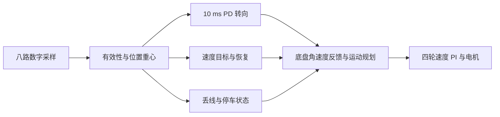

# 循迹开源代码对照与本车适配

查阅日期：2026-10-29。本次是源码对照与学习记录，没有修改控制代码、默认参数或固件。链接指向公开分支，后续上游内容可能变化。

## 主要参考

### Pololu 官方 3pi+ 循迹示例

[LineFollowerPID.ino](https://github.com/pololu/pololu-3pi-plus-32u4-arduino-library/blob/master/examples/LineFollowerPID/LineFollowerPID.ino)

重点读 `calibrateSensors`、`showReadings` 和 `loop`：先校准并观察每个探头，再用线位置计算偏差，用 P 和 D 得到左右电机差速，最后限制电机输出。这个示例的纠偏实际没有使用积分项。官方也说明换电机、赛道或提高速度后需要重新调整参数。

适合借鉴的是可观察的调试过程和简洁的反馈链路。它的电机输出是驱动指令，不是本车的 mm/s 编码器闭环目标；其参数和输出限幅不能原样替换本车四轮速度 PI。

### Pololu 官方 QTR 位置估计

[QTRSensors.cpp](https://github.com/pololu/qtr-sensors-arduino/blob/master/QTRSensors.cpp)

重点读 `readCalibrated` 和 `readLinePrivate`：前者按每个探头自己的标定范围归一化，后者对有效信号计算位置重心，并在看不到线时根据上次位置保留找线方向。位置计算没有要求所有命中探头严格相邻。

对本车的启发：线位置估计和丢线判定应分别处理。前面“两个命中组就直接无效”的策略过于严格；现已针对实测 40、26 加入局部单缺口容错。与此同时，不宜直接把相隔很远的两组平均成居中，因此保留空间范围限制。

硬件差异：本车 YB-MVX05 的 OUT 是黑白数字量，AD0/1/2 是选通地址；无法通过软件把这个 OUT 还原成 QTR 的连续强度数据。每路灵敏度、安装高度和左右顺序仍需实物校准。

### 有关联研究论文的 STM32 八路项目

[STM32-Line-Follower-with-PID](https://github.com/sametoguten/STM32-Line-Follower-with-PID)

[实际控制代码 main.c](https://github.com/sametoguten/STM32-Line-Follower-with-PID/blob/main/LineFollower/Core/Src/main.c)

[关联论文：PID Controller Optimization for Low-cost Line Follower Robots](https://arxiv.org/abs/2111.04149)

该项目使用 F103、QTR-8RC 和两轮底盘。可辅助学习 `QTR8_read` 的位置权重、`PID_control` 的误差历史、`sharp_turn` 的方向记忆。它的 RC 充放电采样和直接 PWM 控制不适用于本车的 MUX 数字传感器和四轮速度闭环。

需要有选择地参考：所查阅版本在检查 `actives==0` 前就执行了 `pos/active`，全白时存在除零风险；部分历史量依赖循环次数。关联论文不代表可以整份直接用于本车。主参考仍选 Pololu 官方示例。

## 当前工程对应关系

以下是对本地源码的检查与工程判断，不是外部项目已经验证本车的结论。

| 要点 | 本车当前实现 | 处理结论 |
|---|---|---|
| 位置重心 | `Line_Decode` 按实际命中探头计算归一化偏差 | 已有；保留掩码便于查漏检 |
| 局部缺口 | 最多四路跨度内，仅允许中间缺一路 | 上一版已加入，40/26 可以继续纠偏 |
| PD 转向 | 固定约 10 ms 更新；D 除以实际间隔并滤波；角速度限幅 | 已有；不能套用外部按循环差分的增益 |
| 重新看到线 | 重置 D 的历史，避免丢线期间的误差变化形成尖峰 | 已有 |
| 短暂丢线 | 单独记录事件；非零无效图样最多确认 20 ms，受限速度保持上次转向；全白或确认失败降至 60，持续 120 ms 锁存停车 | 已有；不采用无时限原地找线，不把不可靠重心当作新位置 |
| 速度恢复 | 当前调参为保持 100 ms，再按 160 mm/s² 限制增速 | 已有；实际轮速仍由底盘规划执行 |
| 终点横线 | 距离/转角门限加持续确认；容错缺口不当作横线 | 已有；不能只按命中探头数量停车 |

## 对照着读本车代码

1. [line_sensor.c](Core/Src/line_sensor.c)：选通地址、等待稳定、读取 OUT。
2. [line_control.c](Core/Src/line_control.c)：先看 `Line_Decode`，理解 40/26 的重心与单缺口判定；再看 `Line_Step` 的 PD、速度原因和丢线状态。
3. [chassis_control.c](Core/Src/chassis_control.c)：`Chassis_SetTrackingVelocity` 接收车体速度/角速度，底盘执行轮速分配和速度闭环。

本车偏差是 -1～1，转向输出单位是 centirad/s，速度单位是 mm/s。外部示例的位置范围、控制周期、输出单位不同，Kp/Kd 数字没有直接可比性。

## 下一次实车验证

源码对照这一轮没有改变固件；随后为圈速调试新增了 RUN 的 LMIN 参数，详见工程 README 和 VERIFICATION。当前上传快照的正常弯道下限为 350 mm/s，低速验收时应显式设置 LSPD/LMIN。

先使用 RUN、LSPD=120、LMIN=140 验证 40/26 不再引起无效计数增加或目标跌到 60；观察 CSV 第 22、25、31、34、35、36 列。稳定后再升到 180，检查普通纠偏减速与新的无效事件是否仍出现。每轮固定速度和 PD，只改变一个条件，并保留同一时间段数据。

若使用实体 START，先设置 LMODE=0；默认按键启动 LAP，LSPD 只控制 RUN。只有探头数据稳定后，才能根据直线摆动和弯道跟随情况决定调整 P 或 D。
